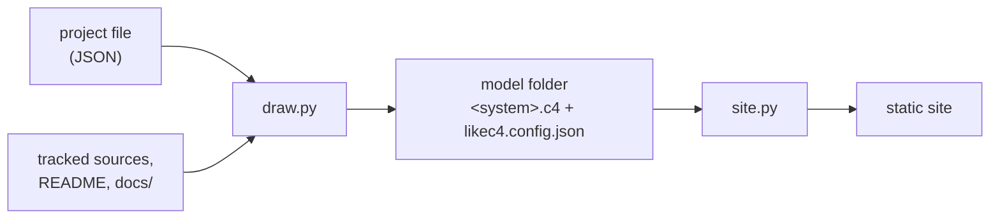

# c4tree

c4tree draws a [C4 model](https://c4model.com) of a C or C++ project from its tracked sources and
writes it as a [LikeC4](https://likec4.dev) site. A JSON project file names the people, systems and
containers and says which folders to scan. Folders become components, and `#include`s become arrows.



It needs Python 3.14 and Node 24 (see `.python-version` and `.node-version`). It is usually added
to a project as a submodule. From the project's checkout:

```sh
git submodule add https://github.com/jose-villegas/c4tree third_party/c4tree
python3 -m pip install -r third_party/c4tree/requirements.txt
npm ci --prefix third_party/c4tree
python3 third_party/c4tree/draw.py --project <project.json> --root . -o build/model
python3 third_party/c4tree/site.py build/model -o build/site --base /<repository>/ --open index
```

[`draw.py`](draw.py) writes the model folder. [`site.py`](site.py) validates it and builds the
site. The site's root lists every view; `--open index` makes it open the context diagram instead.

## What it draws

| Level | Boxes | Read from |
|---|---|---|
| Context | the system, people, outside systems | the README's title and first paragraph; the project file |
| Containers | what the system is built into | each container's describing file (its top comment, docstring or first paragraph) |
| Components | one per source folder under a scan root, nested by folder | the folder's `README.md`, else a source named for the folder (inside it, one ending `_<folder>` inside it, then one beside it), else its doc section; else the folder has no words |
| Modules | a source and the same-stem header it includes | the files' top comments; a module with none fails the build |

Arrows count `#include`s between modules. Every arrow stays in the model. Each component view
hides an arrow when another path in that view already joins the same two boxes. The component
views also hide tests, tools and generated files. The detail container's `<id>_all` view shows
them, and the Context and Containers views show everything.

## The project file

Every key is required, and an unknown key fails the build:

```json
{
  "people": [{"id": "developer", "name": "Developer", "description": "Builds and runs it."}],
  "systems": [{"id": "engine", "name": "Engine", "description": "The library it runs.",
               "folder": "third_party/engine"}],
  "containers": [{"id": "app", "name": "App", "technology": "C++20", "file": "src/main.cpp"}],
  "relations": [{"from": "developer", "to": "app", "label": "runs"},
                {"from": "app", "to": "engine", "label": "links"}],
  "detail": "app",
  "scan": ["src", "tests"],
  "include_roots": ["src"],
  "headers": [".hpp", ".h"],
  "sources": [".cpp"],
  "vendor_includes": "^(SDL3/|imgui)",
  "generated": "Generated by [a-z_]+\\.py"
}
```

| Key | Holds |
|---|---|
| `people` | who uses the system: `id`, `name`, `description` (what they do with it) |
| `systems` | the software around it: `id`, `name`, `description`, `folder` (what it stands for, such as a submodule, or `null`); a folder the tree no longer holds fails the build |
| `containers` | what the system is built into: `id`, `name`, `technology`, `file` (whose opening describes it) |
| `relations` | `from`, `to` and `label` (what flows) between any of the above |
| `detail` | the container whose components the component views draw |
| `scan` | source roots; each folder under them is a component |
| `include_roots` | where an `#include` is looked up after the including file's own folder |
| `headers`, `sources` | the suffixes that make a module, in the order a folder's words are looked for |
| `vendor_includes` | a regular expression matched at the start of an include name; matching outside headers are listed in a module's metadata |
| `generated` | a regular expression, or `null`; a file with a match in its first five lines is described as "Generated file.", and a source so marked is hidden from the component views |

A test is a file in a `test/` or `tests/` folder, or one named `test_*`, `suite_*`, `*_test` or
`*Test`. A tool is a file in a `tools/` folder. Only files `git ls-files` lists are read.

## Building on it

Some projects know more than their tree, such as which build image compiles each file. Such a
project calls `draw.build_data()` from its own script and adds to the data before
[`likec4.py`](likec4.py) writes it:

| Adds | How |
|---|---|
| packages | `build_data(..., packages={root: name})`: each root becomes a container of its own, its words required; its headers sit under an include root inside it, its sources under `src/` |
| vendored headers | `vendored`: tracked files an outside include may name; a module's metadata links one when exactly one matches |
| more outside boxes | `outside`: boxes beside the project file's `systems` that relations may name |
| tags on modules | a `tags` list on any file record; a module carries every tag its files carry |
| colours for tags | `tag_colours`: tag to colour |
| more component views | `views`: each `{suffix, title, hide}` draws the detail container again without the tags in `hide` |
| build requirements | `links` and `link_notation`: dashed arrows between containers, components and `libraries` |
| deployment | a second `.c4` file in the model folder; `likec4.place()` names each container to point at |

## Links

When `origin` is a GitHub remote, each box links to its file at the merge base of `HEAD` and the
remote's default branch (`origin/HEAD`, else `origin/main`). A site built from a local merge then
still links to pages that exist. Without either ref it links at `HEAD`. Without a GitHub `origin`
the boxes carry no links.

## Tests

```sh
python3 -m unittest discover -s tests
```

The validator tests need `npm ci` first.

## Licence

[GPL-3.0](LICENSE).
